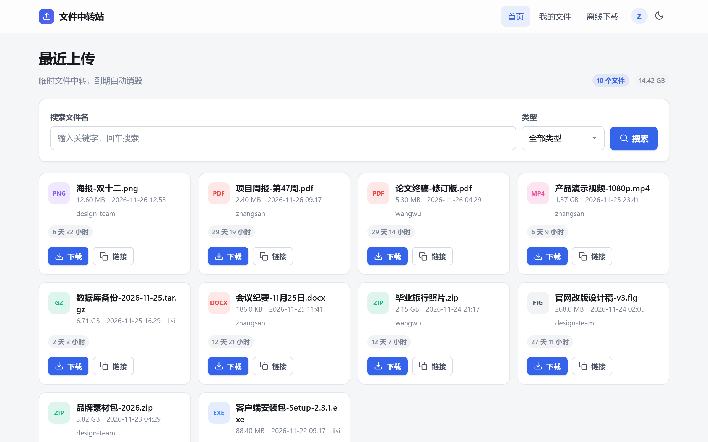
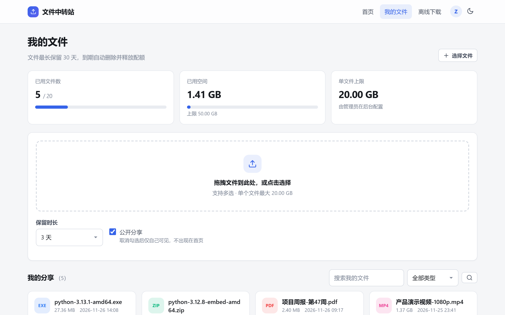
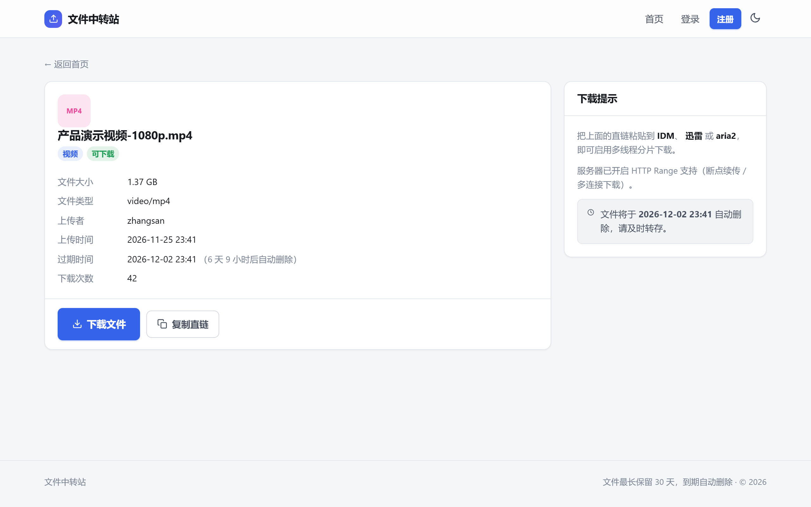
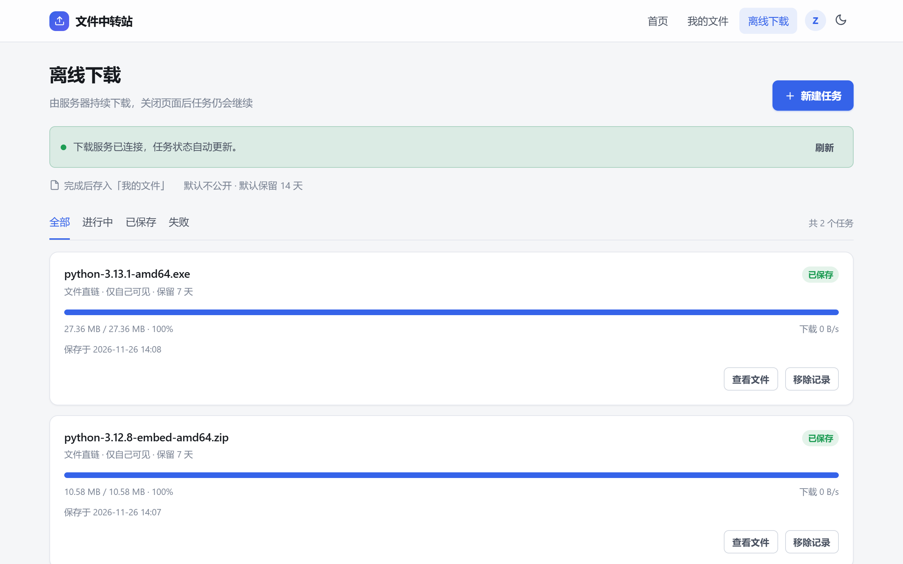
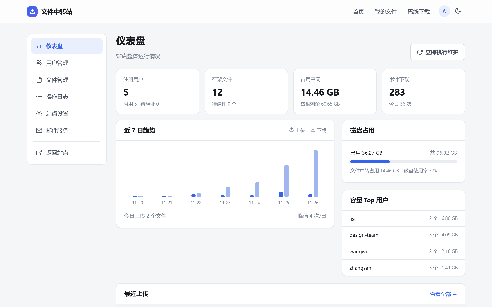
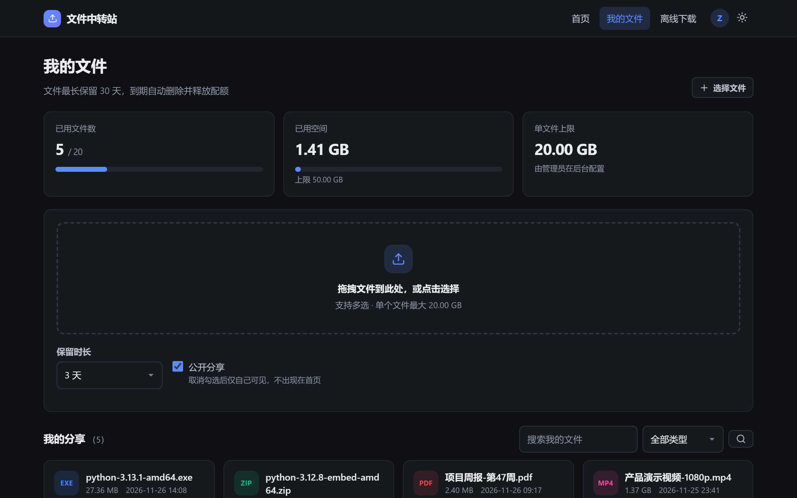

# 文件中转站

[](https://github.com/lingmo77/FileTransit/releases/latest) [](LICENSE)  

自托管的临时文件中转网盘：上传文件、生成分享链接，到期自动删除并释放空间。适合团队内部传大文件、临时分发安装包和资料。完整版自带离线下载（HTTP/HTTPS、磁力、BT），一条 `docker compose up -d` 即可运行。



## 功能

- **上传与分享**：拖拽或多选上传，单文件默认上限 20 GB；每个文件有独立分享页和直链，可选公开到首页或仅自己可见。
- **到期自动清理**：上传时选择保留时长，到期自动删除并释放配额；管理员可让指定用户长期保存。
- **匿名上传**（默认关闭）：后台开启后，未登录用户也能上传，文件最多保存 1 天；按 IP 和全站限制次数、体积与并发，防止批量上传占满空间。
- **下载友好**：访客无需登录即可下载公开文件；支持 HTTP Range 断点续传，直链可交给 IDM、迅雷、aria2 多线程下载。
- **离线下载**（完整版）：提交 HTTP/HTTPS 链接、磁力链接或种子，由服务器下载后存入「我的文件」；可限速、限并发，并禁止访问内网地址。
- **配额管理**：按用户限制文件数和总容量，默认值可在后台调整。
- **管理后台**：运行概况与 7 日趋势、用户管理、文件管理、操作日志（上传、下载、匿名操作都有记录，可导出）、站点设置、邮件服务（注册验证、找回密码）。
- **数据库可选**：完整版默认内置 PostgreSQL，也可改用 SQLite 或外置 PostgreSQL；附带 SQLite → PostgreSQL 迁移工具。
- **其他**：浅色 / 深色主题，登录与上传限流，HTTPS 反向代理部署。

## 界面预览

| 我的文件 | 分享页 |
| --- | --- |
|  |  |
| **离线下载** | **管理后台** |
|  |  |

<details>
<summary>深色主题</summary>



</details>

## 快速开始

服务器需要 Linux amd64、Docker 25+ 和 Compose v2.24+。从 [Releases](https://github.com/lingmo77/FileTransit/releases/latest) 下载完整版安装包，然后：

```bash
tar xzf file-transfer-full-1.6.0.tar.gz
cd file-transfer
docker load -i images-1.6.0.tar
docker compose up -d
```

打开 `http://服务器地址:8000`，用 **admin / admin** 登录，首次登录会要求修改密码。要使用离线下载，先在后台「站点设置」里填写站点地址。

## 两个版本

| | 完整版（推荐） | 源码版 |
| --- | --- | --- |
| 安装包 | `file-transfer-full-1.6.0.tar.gz` | `file-transfer-src-1.6.0.tar.gz` |
| 内容 | `docker-compose.yml`、`.env`、镜像包 `images-<版本>.tar`（网盘、Aria2 和官方 `postgres:18.7-trixie`）、数据库初始化脚本 `db/` | 应用源码、数据库迁移与初始化脚本、迁移工具、`requirements.txt`、配置模板 |
| 运行方式 | `docker load` + `docker compose up -d` | Python 虚拟环境 + uvicorn |
| 离线下载 | 自带 | 不包含 |
| 数据库 | 内置 PostgreSQL（默认）、SQLite 或外置 PostgreSQL | SQLite（默认）或 PostgreSQL |
| 环境要求 | Linux amd64，Docker 25+，Compose v2.24+ | Python 3.12+ |

两个版本的初始管理员都是 **admin / admin**，签名密钥首次启动时自动生成并保存在数据目录。

## 完整版（Docker）

安装步骤见[快速开始](#快速开始)。配置写在 `docker-compose.yml` 旁边的 `.env` 里（安装包自带，按默认值即可启动）；要改端口、数据库等设置时直接编辑它，然后执行 `docker compose up -d` 生效。默认占用 8000 TCP 和 16881 TCP/UDP（BT），分别由 `FT_PORT`、`FT_ARIA2_BT_PORT` 修改。

所有数据都在 `file-transfer/data/` 下，内置数据库的密码在 `.env` 里，备份或搬家时两者一起带走：

| 目录 | 内容 |
| --- | --- |
| `data/app` | 上传的文件、签名密钥；使用 SQLite 时还有数据库 `app.db` |
| `data/postgres` | 内置 PostgreSQL 的数据库文件 |
| `data/offline`、`data/aria2` | 离线下载的临时文件和下载引擎状态 |

常用命令（在 `file-transfer` 目录执行）：

```bash
docker compose ps                 # 状态
docker compose logs -f --tail=100 # 日志
docker compose restart            # 重启
docker compose down               # 停止并移除容器，data/ 里的数据不受影响
```

### 数据库

数据库配置在 `.env` 开头：

```dotenv
DB_BUILTIN=true        # true：内置数据库（默认）；false：外置数据库，为空使用sqlite
DB_HOST=
DB_PORT=5432
DB_NAME=
DB_USER=
DB_PASSWORD=
```

| 配置 | 数据库 |
| --- | --- |
| `DB_BUILTIN=true`（默认） | 内置 PostgreSQL，其余几项都不用填。不映射端口，只有网盘容器能访问 |
| `DB_BUILTIN=false`，填写 `DB_HOST` 等 | 外置 PostgreSQL，见[外置 PostgreSQL](#外置-postgresql) |
| `DB_BUILTIN=false`，`DB_HOST` 为空 | SQLite，数据库文件为 `data/app/app.db` |

内置数据库的密码首次启动时随机生成，写进 `.env` 的 `DB_PASSWORD`（`.env` 随之改为只有属主可读写）。之后不要修改或删除这一行：数据库已经用这个密码初始化，改了网盘就连不上；这一行丢失时数据库容器会拒绝启动，不会另生成一个新密码。

改为 `false` 时，需要自己编辑 `docker-compose.yml`，删除标有「内置 PostgreSQL」的两处：`app` 服务的整个 `depends_on`，以及整个 `db` 服务。然后执行 `docker compose up -d --remove-orphans`。切换数据库**不会搬迁数据**，换库前先看[迁移到 PostgreSQL](#迁移到-postgresql)。

内置数据库直接使用官方镜像 `postgres:18.7-trixie`（随镜像包导入，镜像名不变），首次启动自动建库建表，不需要手动导入。要直接查看内置数据库：`docker compose exec db psql -U filetransfer`。

### 外置 PostgreSQL

完整版和源码版用法相同。安装包解压后的 `db/` 目录里有初始化脚本：

| 文件 | 用途 |
| --- | --- |
| `db/init-postgresql.sql` | PostgreSQL：建好全部表，写入默认设置和管理员 **admin / admin**（首次登录强制修改密码） |
| `db/init-sqlite.sql` | SQLite 的同款脚本，一般用不到（网盘找不到数据库文件时会自动创建） |

导入是可选的：不导入时，网盘第一次连上空库会自动完成同样的初始化。需要先把库准备好（例如由 DBA 建库、或想先确认表结构）时，按下面的步骤导入。

1. 在 PostgreSQL 上建空库和账号（例如库 `filetransfer`、账号 `filetransfer`），在数据库服务器上执行：

   ```bash
   sudo -u postgres createuser -P filetransfer          # 按提示设置密码
   sudo -u postgres createdb -O filetransfer filetransfer
   ```

2. 在 `file-transfer` 目录导入初始化脚本。本机装有 `psql` 时：

   ```bash
   psql -h 数据库地址 -p 5432 -U filetransfer -d filetransfer -q -v ON_ERROR_STOP=1 -f db/init-postgresql.sql
   ```

   没有 `psql` 的话，完整版可以借用镜像包里的 PostgreSQL 镜像（`docker load` 之后即可使用）：

   ```bash
   docker run --rm -i -e PGPASSWORD='密码' postgres:18.7-trixie \
       psql -h 数据库地址 -p 5432 -U filetransfer -d filetransfer -q -v ON_ERROR_STOP=1 < db/init-postgresql.sql
   ```

   导入成功时没有任何输出；出错会停在第一条失败的语句并返回非零。脚本在一个事务里执行，失败时库保持原样。
   可以用 `psql ... -c "select username from users"` 确认，能看到 `admin` 和匿名上传用的系统账号 `@anonymous`。

3. 修改 `.env`，然后启动或重启网盘（完整版还要按上一节删除 `docker-compose.yml` 里的两处）：

   ```dotenv
   DB_BUILTIN=false
   DB_HOST=数据库地址
   DB_PORT=5432
   DB_NAME=filetransfer
   DB_USER=filetransfer
   DB_PASSWORD=密码
   ```

4. 用 **admin / admin** 登录，按提示修改密码。

注意：

- 密码照原样填写，不需要 URL 编码；含空格或 `#` 时用英文双引号括起来。
- 完整版在容器里运行，`DB_HOST` 不能写 `127.0.0.1`（那是容器自己）；数据库在宿主机上时写宿主机局域网 IP，并让 PostgreSQL 监听该地址、在 `pg_hba.conf` 放行 Docker 网段。上面用 `docker run` 导入时同理。
- 脚本只能用于空库。要把已有的 SQLite 数据搬过来，不要导入脚本，直接用[迁移工具](#迁移到-postgresql)。
- 上传的文件和签名密钥仍在数据目录，必须继续保留和备份；数据库另用 `pg_dump` 备份。

## 源码版

```bash
tar xzf file-transfer-src-1.6.0.tar.gz
cd file-transfer
python3 -m venv .venv
.venv/bin/pip install -r requirements.txt
cp .env.example .env    # 可选，按需修改端口、数据目录、数据库等
.venv/bin/uvicorn app.main:app --host 0.0.0.0 --port 8000 --workers 4 --no-proxy-headers
```

启动时自动建库或迁移。数据默认在 `data/`，`FT_SECRET_KEY` 留空时密钥保存在 `data/.secret_key`，请和数据库一起保留。长期运行可用 systemd 托管上面的 uvicorn 命令（`WorkingDirectory` 指向解压目录，使用 `.venv/bin/uvicorn` 的绝对路径）。

### 源码版数据库

默认 SQLite（`DB_BUILTIN=false` 且 `DB_HOST` 为空，数据库为 `data/app.db`），不需要额外服务。源码版没有内置数据库，`DB_BUILTIN` 保持 `false`；改用 PostgreSQL 按[外置 PostgreSQL](#外置-postgresql) 操作。

## 迁移到 PostgreSQL

两个版本都带迁移工具 `app.tools.sqlite_to_postgresql`，把 SQLite 里的数据导入当前配置的 PostgreSQL：

- 源默认是数据目录里的 `app.db`，可以用 `--sqlite 路径` 指定。源文件只读，不会被改动，迁移后可以留作备份。
- 目标库已有数据时会拒绝导入。网盘在 PostgreSQL 上启动过一次、或导入过初始化脚本，库里就已有管理员和默认设置，这时确认用 SQLite 的数据覆盖，加 `--overwrite`。
- 整个导入在一个事务里完成，中途出错时目标库保持原样。旧版本的 SQLite 会先在临时副本上升级到当前表结构再导入。
- 上传的文件和签名密钥都在数据目录里，不需要搬动。

完整版（`.env` 里 `DB_BUILTIN=true`，或为 `false` 并填好了外置数据库；`data/app/app.db` 是要迁移的库）：

```bash
docker compose stop app
docker compose run --rm app python -m app.tools.sqlite_to_postgresql
docker compose up -d
```

源码版：先停止网盘，在 `.env` 里按[外置 PostgreSQL](#外置-postgresql) 配好数据库（不要导入初始化脚本），再执行：

```bash
.venv/bin/python -m app.tools.sqlite_to_postgresql
```

完成后启动网盘，确认用户、文件和设置都在。

## 备份与恢复

完整版的数据都在 `data/` 下，停机后连同配置一起打包即可：

```bash
docker compose stop
tar czf file-transfer-backup-$(date +%F).tar.gz data .env docker-compose.yml
docker compose start
```

恢复：把备份解压到 `file-transfer` 目录，`docker load` 同版本的镜像后执行 `docker compose up -d`。`data/postgres` 和 `.env` 必须来自同一份备份，否则内置数据库的密码对不上。

源码版：停止网盘后备份数据目录（默认 `data/`）和 `.env`；使用外置 PostgreSQL 时另用 `pg_dump` 备份数据库。

## HTTPS 反向代理

放在 Nginx / Caddy 后面时，在 `.env` 设置 `FT_TRUST_PROXY=true`、`FT_COOKIE_SECURE=true`；源码版还要把启动参数 `--no-proxy-headers` 换成 `--proxy-headers --forwarded-allow-ips 127.0.0.1`。只允许代理访问应用端口。

```nginx
location / {
    proxy_pass http://127.0.0.1:8000;
    proxy_set_header Host $host;
    proxy_set_header X-Forwarded-For $proxy_add_x_forwarded_for;
    proxy_set_header X-Forwarded-Proto $scheme;
    proxy_buffering off;
    proxy_request_buffering off;
    client_max_body_size 20480m;
    proxy_read_timeout 3600s;
}
```

## 匿名上传

默认关闭。在后台「站点设置 → 匿名上传」勾选「允许未登录用户上传文件」后，导航栏出现「匿名上传」（`/upload`），未登录用户可以上传：

- 保留时长 1 小时到 1 天（上限可在后台调小），到期自动删除；文件凭链接下载，默认不出现在首页。上传完成后页面直接给出分享页和直链，请提醒用户自己保存。
- 防止批量上传的限制，都可在同一页调整：单文件上限（默认 100 MB）、每个 IP 24 小时内的文件数（10 个）和总量（1 GB）、全站每小时文件数（100 个）、匿名文件同时占用的总空间（10 GB）、全站同时接收的匿名上传数（2 个，每个 IP 同时只能传 1 个），另有按 IP 的请求频率限制。
- IP 限额按数据库里的上传记录统计，多个 worker 之间也准确，文件到期或被删后仍然计入；IPv6 按 /64 网段统计。
- 放在反向代理后面时必须设置 `FT_TRUST_PROXY=true`，否则所有访客会被当成同一个 IP，很快一起用完额度。

日志（后台「操作日志」）：每次匿名上传记一条「匿名上传」，含 IP、浏览器、文件名、大小、SHA-256、保留时长和来源页；被拒绝的记「匿名上传被拒」并写明原因（未开放、超过大小、超过 IP 或全站额度、繁忙等），同一 IP 同一原因 60 秒内只记一条，并注明期间省略的次数。所有下载（含匿名下载）都记「下载文件」，含文件名、大小、请求范围和来源页；多线程下载只记一次。后台「文件管理 → 只看匿名上传」列出所有匿名文件及上传 IP。

## 离线下载（完整版）

登录后台，把“站点地址”填成用户实际访问的地址（如 `https://pan.example.com`），离线下载才会开始工作。

下载引擎在独立容器里，拒绝访问内网、回环、链路本地、Docker 网段和非公网 IPv6，并自动封锁站点地址解析出的 IP，防止被用来探测内网；磁力、BT 和跳转同样受限。地址未填或保护未就绪时离线任务暂停，普通上传下载不受影响。

- `FT_ARIA2_BLOCKED_NETWORKS`：可选的额外禁止 IP/CIDR，逗号分隔，例如 CDN 后面的源站公网地址；普通部署留空。
- 不要把 Aria2 的 RPC 端口 6800 开放到公网；RPC 密钥由下载容器自动生成，不映射到宿主机。

## 升级

数据库迁移在启动时自动完成，升级前请先[备份](#备份与恢复)。

- **完整版**：在原目录的上一级解压新包，跳过包里的 `.env`（原来的 `.env` 里有数据库密码，不能被覆盖），再导入镜像并启动：

  ```bash
  tar xzf file-transfer-full-<新版本>.tar.gz --exclude=file-transfer/.env
  cd file-transfer
  docker load -i images-<新版本>.tar
  docker compose up -d
  ```

  如果你按上面的说明删过 `docker-compose.yml` 里的内置 PostgreSQL，新包里的同名文件要再删一次。
- **源码版**：覆盖程序文件，保留 `.env`、`data/`、`.venv/`，执行 `.venv/bin/pip install -r requirements.txt` 后重启。

### 从 1.4.x 升级

1.4.x 的数据库是 SQLite，`.env` 里的 `FT_SECRET_KEY` 必须保留。

**源码 / 原生安装**：保留 `.env` 和数据目录，按源码版的方式覆盖程序文件。1.5.0 起不再提供一键安装脚本和 `deploy/native-start.sh`，systemd 服务的 `ExecStart` 改为上面的 uvicorn 命令。默认继续使用 SQLite。

**Docker**：1.4.x 把数据放在命名卷里，1.5.0 改为 `data/` 目录，需要复制一次：

1. 在旧目录执行 `docker compose down`（数据卷保留），用 `docker volume ls` 找到旧卷，名字形如 `<旧项目名>_ft-data`；用过离线下载的还有 `_ft-offline`、`_ft-aria2-state`。
2. 把新版本解压到新目录，`docker load` 镜像，把旧 `.env` 里改过的设置（至少 `FT_SECRET_KEY`）填进新包自带的 `.env`。
3. 把卷里的数据复制到 `data/`（以 `ft-data` 为例，另外两个卷分别复制到 `data/offline`、`data/aria2`）：

   ```bash
   mkdir -p data/app
   docker run --rm --entrypoint sh -v <旧项目名>_ft-data:/from:ro -v "$PWD/data/app":/to \
       file-transfer:1.6.0 -c 'cp -a /from/. /to/'
   ```

4. 选择数据库：
   - 继续用 SQLite：在 `.env` 里设置 `DB_BUILTIN=false`（`DB_HOST` 留空），按[数据库](#数据库)一节删除内置 PostgreSQL 的两处，然后 `docker compose up -d`。
   - 改用内置 PostgreSQL：执行 `docker compose run --rm app python -m app.tools.sqlite_to_postgresql` 导入数据，再 `docker compose up -d`。
5. 确认网盘数据完整后，再用 `docker volume rm` 删除旧卷。

## 技术栈

FastAPI + Uvicorn（多 worker）、SQLAlchemy 2 异步 + Alembic 迁移、Jinja2 服务端渲染 + 原生 JS/CSS（无前端构建步骤）；离线下载基于 Aria2，运行在独立容器中。

## 开发

目录结构、测试、构建与发布见 [开发说明](DEVELOPMENT.md)，版本变化见 [发布说明](RELEASE_NOTES.md) 和 [Releases](https://github.com/lingmo77/FileTransit/releases)。

## 许可证

[MIT](LICENSE)
